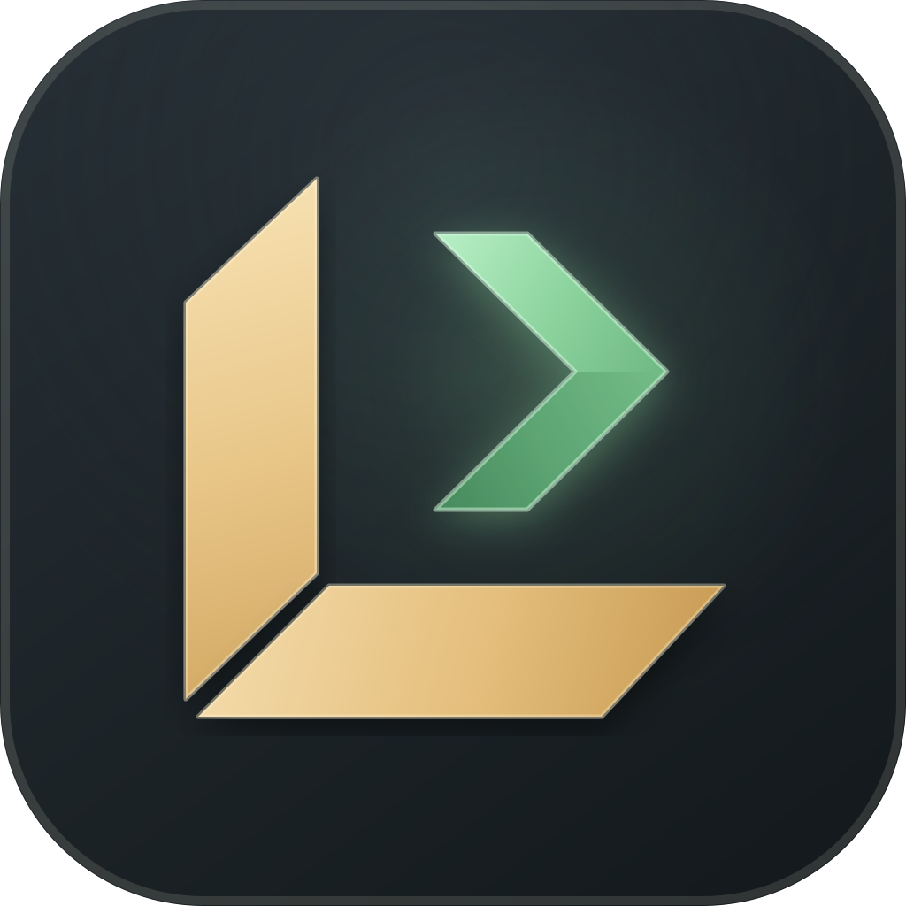

<p align="center">
  
</p>

<h1 align="center">Lework</h1>

<p align="center">
  Cross-platform console for local &amp; remote coding agents (Claude Code, Codex, AGY, Pi, ACP).<br/>
  <strong>English</strong> | <a href="./README.zh-CN.md">简体中文</a> | <a href="./CHANGELOG.md">Changelog</a>
</p>

---

## Overview

Lework pairs a lightweight **Host Hub** daemon (`hubd`, TypeScript / Node 22+) on your workstation or Linux devbox with native **macOS, iOS, and Android** clients (Kotlin Multiplatform + Compose Multiplatform).

- **Multi-engine**: Claude Code, Codex, AGY, built-in Pi engine, and generic ACP CLIs.
- **Terminal takeover**: Discover running/recent shell sessions on the host, approve `tmux` / `iTerm2` prompts remotely, queue follow-ups, and resume streams across disconnects.
- **Zero-config networking**:
  - **LAN**: Bonjour / mDNS / Android NSD (`_lework._tcp.local`).
  - **Remote**: Embedded user-space Tailscale `tsnet` (same-account auto-handshake, no system VPN or root required), SSH pairing on Desktop, or single-use QR pairing (`lework pair`).
- **Workspace tools**: Isolated Git worktree sessions, inline & workspace diffs, lossless `git stash create` checkpoints/rollback, `@file` mentions, and image inputs.
- **Telemetry & alerts**: Context window meter, incremental multi-engine usage/quota stats, and offline push notifications (Bark, Telegram, Feishu, Webhook).

## Repository Layout

```text
lework/
├─ hub/               # Host Hub daemon & CLI (engines, terminal bridge, worktrees, usage)
├─ app/               # KMP + Compose Multiplatform clients (shared / desktopApp / iosApp / androidApp)
├─ protocol-schema/   # Shared Zod schema -> JSON Schema + Kotlin @Serializable codegen
├─ tsnet-bridge/      # Embedded Go Tailscale tsnet bridge (Host binary + iOS/Android libs)
├─ assets/brand/      # SVG brand mark & generator assets
├─ scripts/           # Setup, tsnet build, iOS/Desktop install, release helpers
└─ docs/              # Architecture design notes (docs/PLAN.md)
```

## Quick Start

### 1. Host Hub (macOS / Linux)

Requires **Node.js >= 22**, **pnpm**, and optionally **Go >= 1.24** (for embedded `tsnet`).

```bash
# Install deps, generate protocol models, build tsnet-bridge, link global `lework` / `hub` CLI
pnpm setup

# Check detected local engines
lework engines

# Start Host Hub (HTTPS/WSS on :64450, advertises _lework._tcp.local)
lework serve

# Generate a single-use QR pairing code (5 min TTL)
lework pair

# Optional: join same-account Tailscale / Headscale mesh
lework tsnet login
```

### 2. Clients

Pre-built **macOS Desktop (`.dmg`)** and **Android (`.apk`)** binaries are published in [GitHub Releases](https://github.com/letrahoo/lework/releases).

Build from source (requires **JDK 17**):

```bash
# macOS Desktop: build & install to /Applications/Lework.app
pnpm desktop:install

# Android APK
./app/gradlew -p app :androidApp:assembleDebug

# iOS (requires macOS, Xcode, xcodegen)
./scripts/ios-install.sh --simulator
APPLE_TEAM_ID=<YOUR_TEAM_ID> ./scripts/ios-install.sh --install [DEVICE_UDID]
```

### 3. Verify & Test

```bash
pnpm verify
```

## Security

| Layer | Mechanism |
| --- | --- |
| Transport | HTTPS / WSS only (self-signed TLS in `~/.lework/tls/`). Relays and tunnels forward ciphertext end-to-end. |
| Trust | Certificate SHA-256 pinning (no custom CA needed). First connection requires HMAC token-bound attestation before credentials leave the client. |
| Storage | macOS/iOS Keychain (device-only, non-iCloud); Android Keystore AES-256-GCM. |
| Auth | Single-use QR pair codes, revocable device tokens (`lework tokens list \| revoke \| revoke-all`), optional pluggable RFC 8628 OAuth (`~/.lework/oauth.json`). |
| Guardrails | Rejects browser `Origin` headers; blocks `~/.ssh`, `~/.lework`, `.env`, and private keys in file APIs; terminal approval verifies screen hash and numeric option allowlist. |

## License

Licensed under [Apache License 2.0](./LICENSE). Third-party notices: [THIRD_PARTY_NOTICES.md](./THIRD_PARTY_NOTICES.md).
