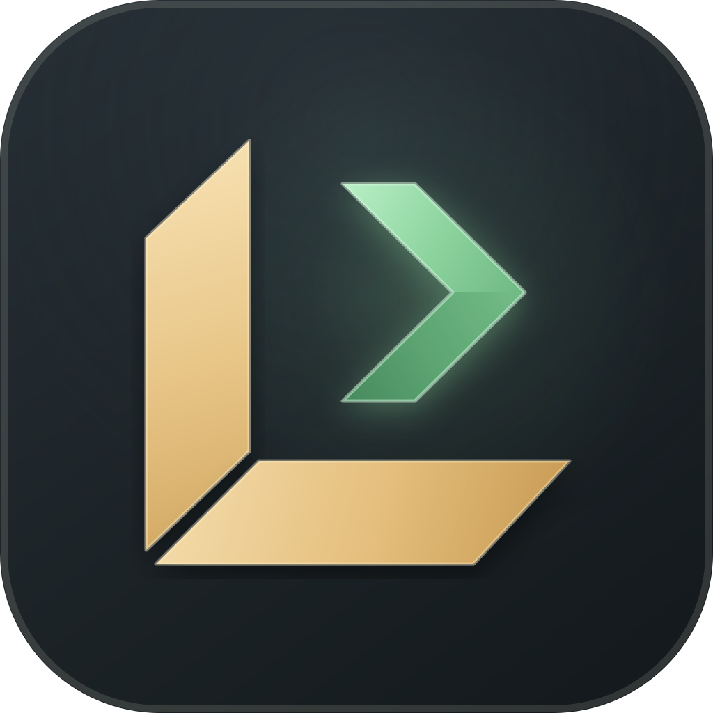

<p align="center">
  
</p>

<h1 align="center">Lework</h1>

<p align="center">
  跨平台多引擎 Coding Agent 控制台（支持 Claude Code、Codex、AGY、Pi、ACP）。<br/>
  <a href="./README.md">English</a> | <strong>简体中文</strong>
</p>

---

## 简介

Lework 由运行在工作站或远端 Linux 开发机上的 **Host Hub** 守护进程（`hubd`，TypeScript / Node 22+）与原生 **macOS / iOS / Android** 客户端（Kotlin Multiplatform + Compose Multiplatform）组成。

- **多引擎接入**：支持 Claude Code、Codex、AGY、内置 Pi 引擎及通用 ACP CLI。
- **本机终端接管**：发现主机正在运行或历史 Shell 会话，支持远程代点 `tmux` / `iTerm2` 审批、排队发送指令及断线按 `seq` 续传。
- **零配置组网**：
  - **局域网**：Bonjour / mDNS / Android NSD（`_lework._tcp.local`）自动发现。
  - **跨网段**：双端内嵌用户态 Tailscale `tsnet`（同账号自动握手，免系统级 VPN/root 权限）、桌面端 SSH 一键配对、一次性二维码配对（`lework pair`）。
- **工作区能力**：独立 Git Worktree 会话隔离、行级与工作区 Diff、基于 `git stash create` 的无损快照与回退、`@文件` 引用及图片多模态输入。
- **用量与通知**：上下文窗口占用条、多引擎增量用量与额度看板、锁屏离线推送（Bark / Telegram / 飞书机器人 / Webhook）。

## 目录结构

```text
lework/
├─ hub/               # Host Hub 守护进程与 CLI（多引擎适配、终端桥接、Worktree、用量统计）
├─ app/               # KMP + Compose Multiplatform 客户端（shared / desktopApp / iosApp / androidApp）
├─ protocol-schema/   # 双端协议单一来源（Zod -> JSON Schema + Kotlin @Serializable 代码生成）
├─ tsnet-bridge/      # 内嵌 Go Tailscale tsnet 桥接（主机侧二进制 + iOS/Android 静态/动态库）
├─ assets/brand/      # 品牌 SVG 与图标资源
├─ scripts/           # 初始化、tsnet 构建、iOS/Desktop 安装与发版脚本
└─ docs/              # 架构设计文档（docs/PLAN.md）
```

## 快速开始

### 1. 启动主机端 Host Hub（macOS / Linux）

依赖 **Node.js >= 22**、**pnpm**，可选 **Go >= 1.24**（用于编译内嵌 `tsnet`）。

```bash
# 安装依赖、生成协议代码、编译 tsnet-bridge、注册全局 `lework` / `hub` 命令
pnpm setup

# 查看本机已识别的 Agent 引擎
lework engines

# 启动 Host Hub（HTTPS/WSS 监听 :64450，自动广播 _lework._tcp.local）
lework serve

# 生成一次性配对二维码（5 分钟有效）
lework pair

# 可选：登录同账号 Tailscale / Headscale 组网
lework tsnet login
```

### 2. 客户端

可直接从 [GitHub Releases](https://github.com/letrahoo/lework/releases) 下载 **macOS Desktop (`.dmg`)** 与 **Android (`.apk`)** 安装包，或从源码构建（需 **JDK 17**）：

```bash
# macOS 桌面端：增量构建并安装到 /Applications/Lework.app
pnpm desktop:install

# Android APK
./app/gradlew -p app :androidApp:assembleDebug

# iOS（需 macOS、Xcode、xcodegen）
./scripts/ios-install.sh --simulator
APPLE_TEAM_ID=<YOUR_TEAM_ID> ./scripts/ios-install.sh --install [DEVICE_UDID]
```

### 3. 全量验证

```bash
pnpm verify
```

## 安全模型

| 层级 | 机制 |
| --- | --- |
| 传输加密 | 仅开放 HTTPS / WSS（自签名证书存于 `~/.lework/tls/`），中继与隧道只转发密文。 |
| 主机身份 | 客户端钉扎证书 SHA-256 指纹（无需安装 CA）；首次连接强制校验 HMAC 令牌绑定证明，通过前不发送凭证。 |
| 凭证存储 | macOS / iOS Keychain（仅本机、不进 iCloud）；Android Keystore AES-256-GCM 硬件加密。 |
| 认证与吊销 | 一次性配对码、可随时吊销的独立设备令牌（`lework tokens list \| revoke \| revoke-all`）、可选插件化 RFC 8628 OAuth（`~/.lework/oauth.json`）。 |
| 边界防护 | 拒绝带 `Origin` 的浏览器请求；文件接口屏蔽 `~/.ssh`、`~/.lework`、`.env` 与私钥；终端审批校验屏幕哈希且仅放行白名单数字选项。 |

## 许可证

基于 [Apache License 2.0](./LICENSE) 开源。第三方组件声明见 [THIRD_PARTY_NOTICES.md](./THIRD_PARTY_NOTICES.md)。
