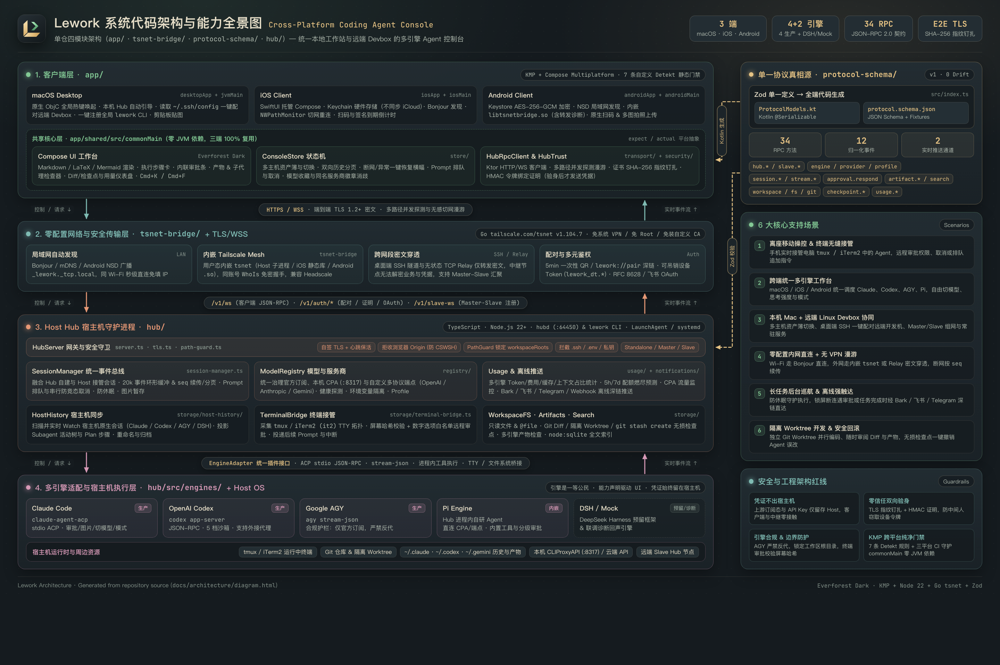

# Lework Architecture & Capabilities

<p align="center">
  
</p>

> English diagram: [lework-architecture.en.png](../assets/architecture/lework-architecture.en.png) · Source template: [docs/architecture/diagram.html](./architecture/diagram.html)

---

## 1. 四模块分层架构（Repository Architecture）

Lework 采用单仓四模块架构，以 **Zod 单一协议真相源** 约束全端通信，将分散在本地工作站与远端 Linux Devbox 的多引擎 Coding Agent 统一收敛至 macOS / iOS / Android 原生客户端：

| 模块 | 技术栈 | 核心职责 | 关键入口 |
| --- | --- | --- | --- |
| **`protocol-schema/`** | TypeScript + Zod | 协议单一真相源，自动生成 JSON Schema、跨端 Fixtures 与 Kotlin `@Serializable` 模型（CI 校验 `0 drift`） | [protocol-schema/src/index.ts](../protocol-schema/src/index.ts)、[protocol-schema/scripts/gen-json-schema.ts](../protocol-schema/scripts/gen-json-schema.ts) |
| **`hub/`** | TypeScript / Node.js 22+ | 宿主机常驻守护进程 `hubd`（`:64450`）与 `lework` CLI：TLS 网关、会话编排、多引擎适配、终端接管、工作区与用量推送 | [hub/src/server.ts](../hub/src/server.ts)、[hub/src/session-manager.ts](../hub/src/session-manager.ts)、[hub/src/cli.ts](../hub/src/cli.ts) |
| **`tsnet-bridge/`** | Go + `tailscale.com/tsnet` | 内嵌用户态 Tailscale 网格桥接（免系统 VPN / 免 Root / 兼容 Headscale）：Host 子进程、iOS 静态库、Android `libtsnetbridge.so` | [tsnet-bridge/internal/mesh/mesh.go](../tsnet-bridge/internal/mesh/mesh.go)、[tsnet-bridge/cmd/lework-tsnet/main.go](../tsnet-bridge/cmd/lework-tsnet/main.go)、[tsnet-bridge/ios/bridge.go](../tsnet-bridge/ios/bridge.go) |
| **`app/`** | KMP + Compose Multiplatform | `commonMain` 共享状态机、安全传输与 Everforest Dark UI（7 条自定义 Detekt 规则守护零 JVM 泄漏）+ 三端薄原生壳 | [ConsoleStore.kt](../app/shared/src/commonMain/kotlin/dev/lework/store/ConsoleStore.kt)、[HubRpcClient.kt](../app/shared/src/commonMain/kotlin/dev/lework/transport/HubRpcClient.kt)、[HubTrust.kt](../app/shared/src/commonMain/kotlin/dev/lework/security/HubTrust.kt) |

### 协议契约速览

- **传输载体**：JSON-RPC 2.0 over WSS（`/v1/ws`），外加 Master-Slave 节点注册通道（`/v1/slave-ws`）与配对/证明/OAuth HTTP 端点（`/v1/auth/*`）。
- **契约规模**：34 个 RPC 方法（`hub.*`、`slave.*`、`engine.*`、`provider.*`、`profile.*`、`workspace.*`、`fs.*`、`git.*`、`session.*`、`stream.*`、`approval.*`、`artifact.*`、`checkpoint.*`、`usage.*`）、2 个服务端推送通道（`stream.event`、`session.updated`）与 12 种跨引擎归一化 `AgentEvent`。

---

## 2. 核心支持场景（Supported Scenarios）

1. **离座移动操控与终端无缝接管**：在电脑 `tmux` / `iTerm2` 中已启动的 Agent 会话，手机端可实时跟进输出、在屏幕哈希与白名单校验下远程代点权限审批、取消执行或排队追加后续指令。
2. **跨端统一多引擎工作台**：在 macOS / iOS / Android 同一套界面中调度 Claude Code、OpenAI Codex、Google AGY 与自建 Pi 引擎，实时切换模型、思考强度（`low` ~ `max`）与权限模式（`default` / `plan` / `acceptEdits` / `auto` / `bypassPermissions`）。
3. **本机 Mac + 远端 Linux Devbox 多主机协同**：客户端内置多主机资产簿与独立凭据存储；桌面端自动引导本机 Mac Hub 并读取 `~/.ssh/config` 一键配对远端开发机；Hub 支持 `standalone` / `master` / `slave` 角色及 `LaunchAgent` / `systemd`（含 `linger`）常驻托管。
4. **零配置内网直连 + 无 VPN 跨网漫游**：局域网通过 Bonjour / mDNS / Android NSD（`_lework._tcp.local`）秒级直连；跨网自动切换至内嵌用户态 `tsnet`（同账号 `WhoIs` 免密握手）或无状态 TCP Relay / SSH 隧道密文穿透，断线后按 `seq` 无损续传。
5. **长任务后台巡航与离线强触达**：Hub 自动抑制宿主机休眠，确保后台长任务持续运行；当移动设备锁屏离线时，审批请求与长耗时轮次完成/失败经 Bark / 飞书机器人 / Telegram / Webhook 推送并携带 `lework://session` 深链直达。
6. **隔离 Git Worktree 开发与无损回滚**：为并行任务一键创建独立 Git Worktree 隔离改动；随时审阅行级与工作区 Diff 及多引擎会话产物，并通过无损 `git stash create` 检查点一键撤销误改。

---

## 3. 核心能力矩阵（Capabilities）

### 多引擎适配与模型治理

| 引擎 | 类型 | 状态 | 协议 / 机制 | 源码 |
| --- | --- | --- | --- | --- |
| **Claude Code** | `cli` | 生产可用 | `@agentclientprotocol/claude-agent-acp` stdio JSON-RPC ACP | [hub/src/engines/claude-adapter.ts](../hub/src/engines/claude-adapter.ts) |
| **OpenAI Codex** | `server` | 生产可用 | `codex app-server` JSON-RPC，映射 5 档模式沙箱并支持代理参数注入 | [hub/src/engines/codex-adapter.ts](../hub/src/engines/codex-adapter.ts) |
| **Google AGY** | `cli` | 生产可用 | `agy stream-json` 双向流；内置合规护栏，仅允许官方订阅登录、禁止反代 | [hub/src/engines/agy-adapter.ts](../hub/src/engines/agy-adapter.ts) |
| **Pi Engine** | `embedded` | 内嵌自研 | Hub 进程内运行，直连本机 CPA 或外部端点，内置读写/搜索/Bash 与分级审批 | [hub/src/engines/pi-adapter.ts](../hub/src/engines/pi-adapter.ts) |
| **DSH / Mock** | `service` / `embedded` | 预留 / 诊断 | DeepSeek Harness 服务通道框架预留与联调回声引擎 | [hub/src/engines/dsh-adapter.ts](../hub/src/engines/dsh-adapter.ts)、[hub/src/engines/echo-adapter.ts](../hub/src/engines/echo-adapter.ts) |

- **模型与服务商注册中心**（[hub/src/registry/model-registry.ts](../hub/src/registry/model-registry.ts)、[hub/src/registry/provider-adapters.ts](../hub/src/registry/provider-adapters.ts)）：统一治理原生订阅、本机 **CLIProxyAPI**（`127.0.0.1:8317`）与自定义多协议端点（`openai-chat`、`openai-responses`、`anthropic-messages`、`gemini`），具备健康探测、会话级环境变量隔离与 Profile 预设。

### 会话编排、宿主机感知与研发辅助

- **统一事件总线**（[hub/src/session-manager.ts](../hub/src/session-manager.ts)）：单会话 20,000 条事件缓冲，支持 `afterSeq` / `beforeSeq` / `aroundSeq` 续传与双向分页、Prompt 排队与取消（`session.cancelQueued`）、取消与新 Prompt 串行化防竞态、防休眠与图片附件暂存。
- **宿主机原生历史与终端接管**（[hub/src/storage/host-history.ts](../hub/src/storage/host-history.ts)、[hub/src/storage/terminal-bridge.ts](../hub/src/storage/terminal-bridge.ts)）：实时 Watch 宿主机原生会话，自动投影 Subagent 活动树与 Plan 执行步骤；通过 `tmux` / `iTerm2`（`it2`）TTY 拓扑远程审批与注入 Prompt。
- **工作区、产物与全文检索**（[hub/src/storage/workspace-fs.ts](../hub/src/storage/workspace-fs.ts)、[hub/src/storage/artifacts.ts](../hub/src/storage/artifacts.ts)、[hub/src/storage/search-index.ts](../hub/src/storage/search-index.ts)）：只读目录/文件预览、`@file` 模糊补全、`git.status` / `git.diff`、隔离 Worktree、无损检查点、多引擎产物检查以及基于 `node:sqlite` 的跨引擎增量全文索引。
- **用量计量与离线通知**（[hub/src/usage/service.ts](../hub/src/usage/service.ts)、[hub/src/notifications/notifier.ts](../hub/src/notifications/notifier.ts)）：跨引擎 Token/估算费用/Cache 命中率/上下文窗口占比、5h & 7d 订阅配额燃尽率预测、CPA Proxy 流量统计与智能延迟离线推送。
- **三端富文本与原生体验**：Everforest Dark 主题下的 Markdown / LaTeX / Mermaid 渲染、执行步骤卡、内联审批条、产物与子代理检查器；桌面端具备全局热键（[LeworkMacHotkey.m](../app/desktopApp/src/native/macos/LeworkMacHotkey.m)）、本机 Hub 自动引导、SSH 配对与全局 `lework` CLI 注册；移动端具备硬件级密钥存储、原生扫码与相机/多图上传。

---

## 4. 安全与工程红线（Security & Engineering Invariants）

- **凭证不出宿主机**：上游模型订阅态与 API Key 仅保存在 Host 本机，客户端与中继节点零接触。
- **端到端加密与零信任验身**：全链路自签 TLS 1.2+ 密文；客户端按 SHA-256 指纹钉扎证书，并在发送任何认证凭据前强制完成 `/v1/auth/attest` HMAC 证明。
- **攻击面收敛**：拒绝带浏览器 `Origin` 的 WebSocket 与非 GET 请求；`PathGuard` 锁定 `workspaceRoots` 并硬拦截 `~/.ssh`、`~/.lework`、`.env` 与私钥；终端远程审批校验屏幕哈希与数字选项白名单。
- **跨平台纯净性门禁**：7 条自定义 Detekt 规则（[app/detekt-rules/](../app/detekt-rules/)）配合 Linux / Android / macOS-iOS 三平台 CI 严格守护 `commonMain` 零 JVM 依赖与协议 `0 drift`。

---

## 5. 重新渲染架构图

架构图源码位于 [docs/architecture/diagram.html](./architecture/diagram.html)（通过 URL 参数 `?lang=zh` 与 `?lang=en` 同时维护中英双语版本）。如需在修改后重新导出高清 PNG，可在 macOS 上使用无头 Chrome 渲染并裁切至 `2880 × 1916`：

```bash
CHROME="/Applications/Google Chrome.app/Contents/MacOS/Google Chrome"
"$CHROME" --headless=new --disable-gpu --no-sandbox --hide-scrollbars \
  --force-device-scale-factor=1.5 --window-size=1920,1360 \
  --screenshot=assets/architecture/lework-architecture.zh-CN.png \
  "file://$(pwd)/docs/architecture/diagram.html?lang=zh"

"$CHROME" --headless=new --disable-gpu --no-sandbox --hide-scrollbars \
  --force-device-scale-factor=1.5 --window-size=1920,1360 \
  --screenshot=assets/architecture/lework-architecture.en.png \
  "file://$(pwd)/docs/architecture/diagram.html?lang=en"
```
