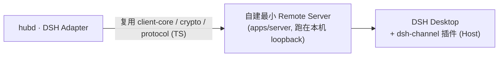
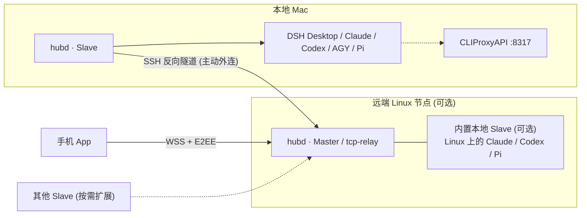
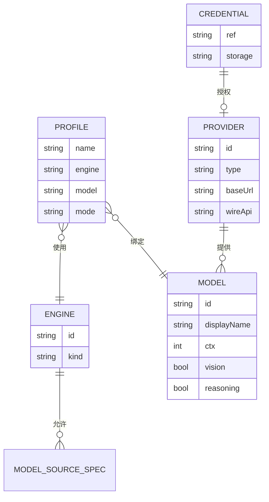
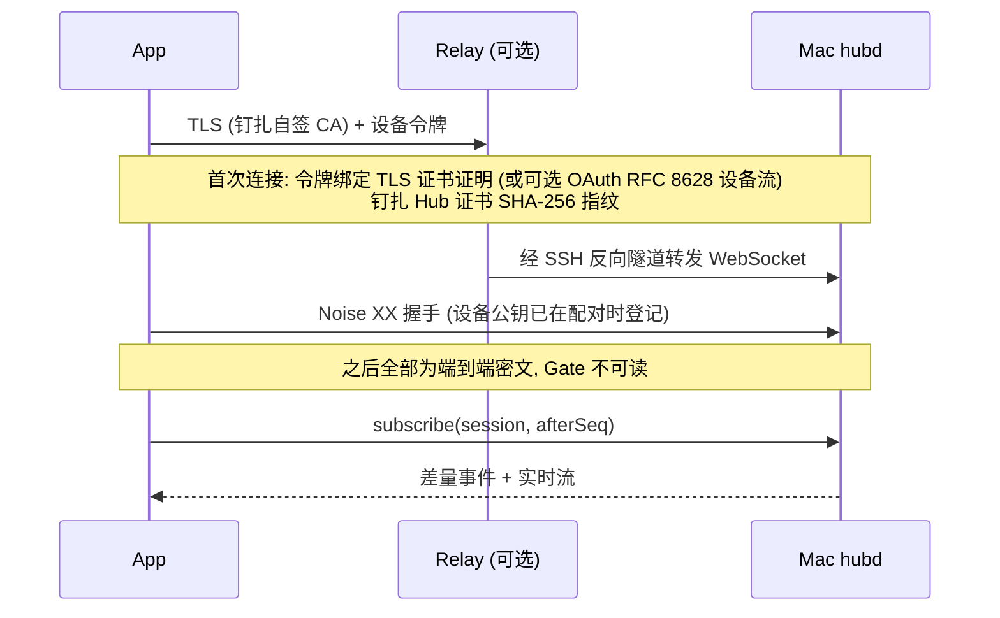
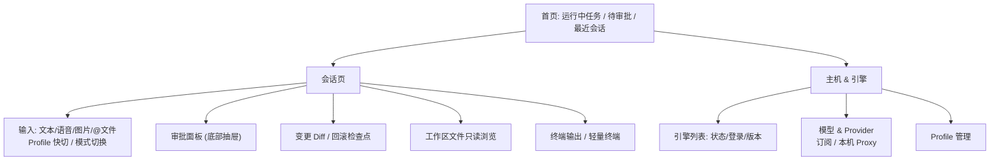

# Lework · 移动端多引擎 Agent 控制台完整方案

> 一个 KMP 手机 App（iOS 优先）+ 可运行在本地工作站与远端 Linux 节点上的 **Host Hub**，在 Hub 上可插拔地挂载任意 Agent 引擎（CLI / Service / Server / 自建 Pi），每个引擎再按自身能力搭配模型与凭证来源（内置订阅 或 本机 API Proxy）。

---

## 0. 决策记录 & 术语

| # | 决策 | 状态 |
| --- | --- | --- |
| D1 | 两端 UI 均用 **Compose Multiplatform**，体验关键点（输入框、长文本选择、Mermaid 等）允许替换为原生组件 | ✅ 已定 |
| D2 | Hub = 运行在引擎所在机器（macOS / Linux）上的常驻守护进程，见下方术语 | ✅ 已澄清 |
| D3 | 多引擎插件化适配器架构，零特定云/内网基建强绑定 | ✅ 已定 |
| D4 | Hub 用 **TypeScript**（Node 22+） | ✅ 已定 |
| D5 | 支持引擎：**Claude Code、AGY、Codex、自建 Pi** 及可选本地 CLI 引擎 | ✅ 已定 |
| D6 | 本机 API Proxy = **CLIProxyAPI v8**（`127.0.0.1:8317`）；Hub 只感知端口/协议/模型列表，不管上游通道，见 §4.4 | ✅ 已定 |
| D7 | iOS 用**本机 Apple 个人开发团队签名**（Xcode 自动管理）；Bundle ID `dev.lework.app`，见 §6.3 | ✅ 已定 |
| D8 | 项目名 **lework**，代码位于 `~/personal/lework` | ✅ 已完成 |
| D9 | 架构分 **Master / Slave** 两种角色；支持局域网 Bonjour 直连，异地可经任意 Linux Relay / Tailscale / WireGuard 接入，见 §3.7 | ✅ 已定 |

**三个角色（避免混淆）**

| 角色 | 跑在哪 | 是什么 | 类比 dsh-channel |
| --- | --- | --- | --- |
| **Client**（App） | 手机 | 只做展示与操作，不跑引擎，不存凭证 | Android / Web Client |
| **Relay**（中继网关，可选） | 任意 Linux 节点 / 云主机 | 解决异地或跨网段无法直连工作站：仅做无状态 TCP 密文转发，**不懂业务、看不到内容** | Remote Server（`relay.example.com`） |
| **Hub**（底座） | Linux（Master）/ Mac（Slave） | 常驻守护进程，分两种角色：**Master** 负责入口、认证、Slave 注册与路由（合并原 Gate）；**Slave** 负责拉起/管理引擎、事件流、审批、模型与凭证编排，见 §3.7 | Host Plugin，但独立于 DSH 运行 |

> Hub 既不是客户端内逻辑，也不是 Remote Connect Server；它是**被控端的引擎管理器**。手机与 Mac 同一 Wi‑Fi 时可不经 Relay 直连 Hub；Relay 只是可替换的"路"。

---

## 1. 现状与痛点

| 现状 | 痛点 | 新方案的对策 |
| --- | --- | --- |
| 手机浏览器 → 临时反代门卫 → SSH 反向隧道 → 单一桌面 Web GUI | 只能绑定单一工具；Web GUI 非移动端设计；自签证书需装 CA；后台即断，无通知 | 原生 App + 端到端 TLS 指纹钉扎（免装 CA）+ 断线 `seq` 续传事件流 + 可选 Webhook/机器人通知 |
| DSH 通过 API 反代接模型 | AGY 等引擎禁止反代，无法纳入；模型与引擎强耦合 | **引擎是一等公民**：AGY 以其官方 CLI + 自带登录运行，不再试图反代 |
| `dsh-channel` 已支持 ACP 多后端 | Host 必须是 DSH 插件；默认依赖公网中转 `relay.example.com`（与"只走内网基建"冲突）；iOS 仅 TestFlight | 借鉴其 adapter / 审批 / 路径校验设计（MIT），但 Hub 独立于 DSH 运行，传输只走内网 |
| 模型配置分散在各 CLI 的私有配置里 | 换模型要 SSH 回去改配置 | Hub 统一的 **Model Registry + Credential Vault**，App 里一键切换 |

**设计原则**

1. **引擎无关**：App 只认统一协议，不认识具体 CLI。
2. **能力驱动 UI**：引擎声明能力（审批、图片、切模型、历史、计划模式…），UI 按能力渐进展示。
3. **凭证不出本机**：订阅登录态、API Key 只在 Mac 的 Keychain / 各 CLI 自有存储中，App 与中继节点都拿不到。
4. **合规优先**：每个引擎只使用它官方允许的模型接入方式（见 §4.3）。
5. **移动端优先的会话模型**：任何时刻断线都能从 `seq` 续传，Agent 在 Host 上继续跑。

---

## 2. 总体架构

```mermaid
flowchart LR
    subgraph Phone["手机 (KMP App)"]
        UI["Compose MP UI<br/>+ iOS 原生扩展"]
        Core["Shared Core<br/>协议/状态/缓存/E2EE"]
    end

    subgraph RelayNode["Relay 节点 (可选中继)"]
        Gate["tcp-relay<br/>无状态 TCP 密文转发"]
    end

    subgraph Mac["本机 Mac"]
        Hub["Host Hub (hubd)<br/>会话/事件日志/审批/路由"]
        Reg["Model Registry<br/>+ Credential Vault"]
        subgraph Engines["Engine Adapters"]
            A1["Claude Code<br/>(claude-agent-acp)"]
            A2["Codex<br/>(codex app-server)"]
            A3["AGY<br/>(agy stream-json)"]
            A4["DSH<br/>(本机 Service API)"]
            A5["Pi Engine<br/>(自建, pi SDK)"]
            A6["通用 ACP<br/>(OpenCode/Cursor/Gemini…)"]
        end
        Proxy["本机 API Proxy<br/>(LiteLLM/new-api/自建)"]
    end

    UI --> Core
    Core -- "WSS + Noise E2EE" --> Gate
    Gate -- "SSH 反向隧道" --> Hub
    Core -. "同局域网直连 (Bonjour)" .-> Hub
    Hub --> Engines
    Hub --> Reg
    A1 & A2 & A5 & A6 -- "可选 base_url" --> Proxy
    A3 -- "仅官方订阅" --> Cloud1[("Google 账号")]
    A1 -- "或官方订阅" --> Cloud2[("Anthropic 账号")]
    A2 -- "或官方订阅" --> Cloud3[("ChatGPT 账号")]
```



三层职责：

| 层 | 组件 | 职责 |
| --- | --- | --- |
| 端 | KMP App | 会话 UI、审批、文件/Diff 浏览、终端、引擎与模型切换、本地缓存 |
| 管 | Host Hub (`hubd`) | 引擎生命周期、统一事件模型、事件日志与续传、审批路由、路径沙箱、模型/凭证编排 |
| 底 | Engine + Model | 真正干活的 Agent；模型来自订阅或本机 API Proxy |

---

## 3. Host Hub（本机底座）

### 3.1 技术选型

**TypeScript + Node 22（或 Bun）**，理由：ACP SDK、`claude-agent-acp`、pi SDK、Codex app-server 客户端都是 TS 生态；可直接复用 `dsh-channel` 的 `packages/crypto/noise.ts` 与 adapter 思路。协议用 **JSON Schema 单一来源**，代码生成 TS 类型与 Kotlin `@Serializable` 类，保证两端一致。

以平台服务常驻：macOS 用 `launchd` LaunchAgent，Linux 节点用 `systemd --user`；附带 `hub` CLI（`hub status / hub engines / hub pair / hub join / hub slaves`）。平台差异收敛在 `platform/` 层：凭证存储（macOS Keychain ↔ Linux libsecret，无桌面会话时退化为 `age` 加密文件 + 0600）、防休眠（`caffeinate` ↔ 无需）、服务安装（plist ↔ unit）。

### 3.2 Engine Adapter SPI

```ts
interface EngineAdapter {
  id: string                       // "claude" | "codex" | "agy" | "dsh" | "pi" | "acp:<name>"
  kind: "cli" | "service" | "server" | "embedded"
  probe(): Promise<EngineStatus>   // 是否安装、是否已登录、版本
  capabilities(): EngineCapabilities
  modelSources(): ModelSourceSpec[]   // 该引擎允许的模型来源（订阅 / base_url / 两者）
  listWorkspaces(): Promise<Workspace[]>
  listSessions(ws): Promise<SessionMeta[]>
  openSession(opts: { cwd; model: ModelBinding; resumeId? }): Promise<SessionHandle>
}

interface SessionHandle {
  prompt(input: UserInput): AsyncIterable<AgentEvent>   // 归一化事件流
  cancel(): Promise<void>
  respondPermission(reqId, decision): Promise<void>
  setModel?(m: ModelBinding): Promise<void>
  setMode?(mode: "ask" | "auto-edit" | "plan" | "yolo"): Promise<void>
  history?(cursor?): Promise<Page<AgentEvent>>
  close(): Promise<void>
}
```

### 3.3 首批引擎接入方式

| 引擎 | 形态 | 接入通道 | 备注 |
| --- | --- | --- | --- |
| Claude Code | CLI | `claude-agent-acp`（ACP stdio）或 Claude Agent SDK | 每会话独立进程；审批走 ACP `request_permission` |
| Codex | CLI/Server | `codex app-server`（JSON-RPC stdio） | Thread/Turn 由 Codex 自己持久化，Hub 只投影 |
| AGY | CLI | `agy --input-format stream-json --output-format stream-json` | **使用 agy 自身登录态，不做任何反代**；dsh-channel 已验证可行 |
| DSH | Service | **dsh-channel 通道**（见 §3.6） | DSH 的工作区/会话/模型由 DSH 自己管理，Hub 只做投影 |
| Pi Engine | Embedded | 自建，见 §5 | 可作为"兜底通用引擎" |
| OpenCode / Cursor / Gemini CLI / Hermes… | CLI | 通用 ACP adapter | 配置 `command/args` 即可，能力取自 `initialize` |

### 3.4 统一事件模型（AgentEvent）

```text
session.started / session.status(idle|running|waiting_permission|error)
message.user
message.assistant.delta / message.assistant.done
reasoning.delta
plan.updated               (todo 列表)
tool.call.started {name, input, kind: read|edit|exec|search|mcp|other}
tool.call.output.delta     (终端输出, 有界)
tool.call.done {status, result, fileChanges[]}
permission.requested {reqId, tool, options[allow_once|allow_session|reject]}
permission.resolved
usage {inputTokens, outputTokens, cost?}
turn.done {reason: end_turn|cancelled|max_tokens|error}
```

- 每个事件带 **单调 `seq`**，Hub 写入 SQLite 事件日志（每会话有界，如 20 MB / 50k 条，冷数据可压缩）。
- App 重连发 `subscribe(sessionId, afterSeq)`，Hub 补发差量 → 解决 iOS 后台挂起断线问题。
- 对自带历史的引擎（Codex、Claude、AGY）日志仅作缓存；对无历史的引擎日志即真相源。

### 3.5 安全边界（继承 dsh-channel 的成熟做法）

- 方法 **编译期 allowlist**，未知方法 fail-closed。
- 所有 `cwd` 做词法 + `realpath` 校验，限定在用户配置的 Workspace Roots 内。
- 审批句柄绑定 `(device, session, engine, processInstance)`，一次性消费，断线不放行。
- 每设备可配置权限档位：只读观察 / 可对话 / 可审批 / 管理员（可改引擎与凭证）。
- 全量审计日志：谁、何时、在哪个会话、批准了什么命令。

### 3.6 DSH Adapter：基于 dsh-channel 通道



- Hub 内的 DSH Adapter 以 **Remote Client** 身份接入 DSH 上的 dsh-channel 插件，复用其 `packages/client-core`、`crypto`、`protocol`（MIT，TS，可直接引用——这也是 Hub 推荐 TS 的理由之一）。
- 信令/Relay 用仓库自带的**最小 Server**（`apps/server`）部署在本机 loopback，**不连公网 `relay.example.com`**，符合"只走内网基建"。
- Adapter 把 Typert Remote 的会话/事件映射为统一 AgentEvent；DSH 的模型切换走 DSH 自身配置，Hub 不干预其 provider。
- 好处：跟随上游插件升级即可获得 DSH 新能力，不必逆向 DSH 私有 HTTP API；无需逆向私有 HTTP API。
- 风险：上游协议仍在 Draft，需锁定插件版本并做契约测试；若最小 Server 能力不足，退路是 Adapter 直连本机 DSH 服务（现有 `dsh-remote-tunnel` 的做法）。

### 3.7 Master / Slave 架构与部署方案

**架构层（与部署无关）**：Hub 有两种角色，同一份 `hubd` 代码按配置运行为其中之一。

| 角色 | 职责 |
| --- | --- |
| **Master** | 整个系统的唯一入口与控制面：App 接入、身份认证（可插拔 OAuth RFC 8628 设备流 + 访问令牌）、Slave 注册表与心跳、把 App 请求按 `slaveId` 路由到目标 Slave（只转发密文）、全局审计 |
| **Slave** | 执行面：主动外连 Master（无需开放入站端口）、运行本机引擎、持有本机凭证与事件日志；E2EE 终点在 Slave，Master 看不到会话内容 |

- 一个系统 = 1 个 Master + N 个 Slave。Master 进程可**同时内置一个本地 Slave**（配置开关），用于直接运行 Master 所在机器上的引擎。
- 哪台机器当 Master 只是部署选择；协议、App、Slave 的实现都不感知 Master 跑在哪里。

**部署层（你的方案）**



| 机器 | 角色 | 说明 |
| --- | --- | --- |
| 远端 Linux 节点 | **Master / Relay**（+ 可选本地 Slave） | `systemd --user` 常驻，提供异地 TCP 密文中继或 Master 节点入口 |
| 本地 Mac | **Slave** | launchd 常驻，沿用现有 SSH 反向隧道外连 Master；DSH、CLIProxyAPI 都在这台 |

要点：
- **端到端加密**：App 与每个 Slave 独立做 Noise 握手，Master 只路由密文。
- **App 视角**：主机列表 = Master 注册表里的在线 Slave，每台显示可用引擎、登录状态；会话归属某个 Slave，Profile 可指定默认 Slave。
- **Slave 接入**：在目标机执行 `hub join <master-url> --token <一次性码>`，自动安装常驻服务并建立隧道；Master 可随时吊销。
- **模型来源随 Slave 走**：Mac 的 CLIProxyAPI 只服务 Mac Slave 上的引擎；远端 Linux Slave 如需使用，另行部署或经隧道映射到远端 loopback。
- **DSH** 为 Mac 桌面应用，只在 Mac Slave 上提供。
- **降级**：Master 不可用时，同一 Wi‑Fi 下 App 可通过 Bonjour 直连 Mac Slave（同样走 E2EE）。

---

## 4. 引擎 × 模型 × 凭证

### 4.1 三个实体



- **Provider** 两类：
  - `subscription`：引擎内置账号（Claude Pro/Max、ChatGPT Plus/Pro、Google 账号、DSH 账号）。Hub 只读取"是否已登录 + 可用模型列表"，不触碰 token。
  - `endpoint`：本机 API Proxy 或任意兼容端点，声明 `wireApi ∈ {openai-chat, openai-responses, anthropic-messages, gemini}`。
- **Credential**：存 macOS Keychain，Registry 中只保留引用 `keychain://hub/<id>`；注入时以环境变量传给子进程，并使用隔离的配置目录（如 `CLAUDE_CONFIG_DIR`、`CODEX_HOME`），不改你日常使用的全局配置。
- **Profile**（App 里最常用的东西）：`引擎 + 模型 + 模式 + 默认工作区`，例如「Claude Code · Opus · 订阅 · auto-edit」「Pi · 本机代理/gpt-x · plan」。一键切换。

### 4.2 Hub 注入方式

| 引擎 | 订阅模式 | Endpoint 模式（本机 API Proxy） |
| --- | --- | --- |
| Claude Code | 使用本机 `claude` 已登录态 | `ANTHROPIC_BASE_URL` + `ANTHROPIC_AUTH_TOKEN` + `ANTHROPIC_MODEL`（需 proxy 提供 `/v1/messages`） |
| Codex | 本机 ChatGPT 登录态 | 隔离 `CODEX_HOME/config.toml` 写入 `model_providers.<x>`（`wire_api = responses/chat`） |
| AGY | 本机 Google 登录态 | **不支持（明确禁用该选项）** |
| DSH | DSH 自身账号 | DSH 自身 provider 配置（由 Hub 调其配置 API 或引导用户在 DSH 内配置） |
| Pi Engine | — | 原生多 provider，直连任意 endpoint，最灵活 |
| 通用 ACP | 视 CLI 而定 | 视 CLI 而定（在 adapter manifest 中声明） |

### 4.3 合规护栏

> [!IMPORTANT]
> - 订阅凭证**只**由其官方客户端使用，Hub 不导出、不转发、不把订阅包装成 API 给其他引擎用。
> - AGY 等明确禁止反代的引擎，Registry 中直接不提供 endpoint 选项，UI 置灰并说明原因。
> - 本机 API Proxy 只承载你合法持有的 API Key / 公司内部模型网关。

### 4.4 本机 API Proxy：CLIProxyAPI 对接

Hub 不重复造网关，把 CLIProxyAPI（下称 CPA）注册为一个 `endpoint` 类 Provider：

| 项 | 对接方式 |
| --- | --- |
| 地址 | `http://127.0.0.1:8317`（与 Hub 同机，保持仅本机监听，**不要**改成局域网可访问） |
| 协议 | CPA 同时暴露 OpenAI Chat / Responses、Anthropic Messages、Gemini 兼容端点 → Claude Code 用 `/v1/messages`，Codex / Pi 用 `/v1/responses` 或 `/v1/chat/completions`，Hub 无需协议转换 |
| 鉴权 | CPA `access.api-keys` 中为 Hub 单独分配一个 key，存 Keychain，按引擎注入子进程环境变量 |
| 模型目录 | Hub 定时拉 `/v1/models` 填充 Registry；App 中显示为「CPA · 模型名」 |
| 运维 | 进程启停沿用 `manage.sh`，Hub 只做健康检查（端口 + `/v1/models`）；用量统计以 Hub 事件流 `usage` 为准，管理 API 仅只读接入（可选） |
| 不做 | Hub 不读取 `auths/` 目录、不调用 CPA 的 OAuth 登录、不改 CPA 配置；CPA 背后接的是哪些上游通道由你在 CPA 侧自行管理，Hub 只感知"端口 + 协议 + 模型列表" |

> [!NOTE]
> 上游通道的合规风险（订阅包装成 API、多账号轮换等）在上一轮已提示过一次，此处不再展开；Hub 层不区分上游类型。

> [!CAUTION]
> `config.yaml` 注释中写有管理后台的明文初始密码，建议修改管理密码并删除该注释；`management.allow-remote` 保持 `false`。

---

## 5. 自建引擎：Pi Engine

基于 pi（`@earendil-works/pi-coding-agent` 的 SDK 与其 `pi-ai` 多 provider 层）在 Hub 内**进程内嵌入**，而不是外挂 `pi-acp`，好处是能完整控制审批、事件与移动端体验。

| 能力 | 设计 |
| --- | --- |
| 模型 | 直接复用 Model Registry 中所有 endpoint，支持会话中途换模型 |
| 工具 | read / write / edit / bash / grep / glob / web_fetch + MCP；每个工具声明风险等级 |
| 审批 | 原生接入 Hub 审批：低风险自动、写文件按模式、`bash` 默认询问，支持"本会话内允许此命令前缀" |
| 检查点 | 每个 turn 前 `git stash`/影子提交，App 上一键回滚 |
| 计划模式 | 只读工具集 + 产出 plan，审批后切执行 |
| 移动端特性 | 语音输入转 prompt、"完成后 Webhook/机器人通知我"、长任务排队 |
| Skills / 规则 | 读取工作区 `AGENTS.md` 与 skills 目录，兼容现有习惯 |

Pi Engine 是"兜底与试验田"：任何第三方引擎做不到的移动端交互，都先在这里实现。

---

## 6. 连接与安全

### 6.1 链路



- **无状态中继 (`tcp-relay.mjs`)**：仅做字节流转发；TLS 在工作站 `hubd` 进程内端到端终止，可选 OAuth 设备流采用插件化 Provider（内置通用 `rfc8628` 与 `feishu`），签发令牌支持 `hub tokens revoke` 随时吊销。
- **端到端加密**：App 与 Hub 之间 Noise XX（X25519 + ChaChaPoly + BLAKE2s，与 dsh-channel 相同方案，可直接复用其测试向量）。即使中继节点被攻破也读不到代码、令牌与对话。
- **配对**：Mac 上 `hub pair` 显示二维码（含 Hub 公钥指纹 + Gate 地址 + 一次性码），App 扫码完成登记——同时解决自签证书信任问题（CA 指纹随二维码下发，App 内钉扎）。
- **本地直连**：同一 Wi‑Fi 时通过 Bonjour 发现 Hub，直接连，延迟更低；协议与加密不变。
- App 内 Face ID 解锁；审批类高危操作可要求二次生物识别。

### 6.2 通知（iOS 无自建 APNs 的折中）

- **v1：可插拔 Webhook / IM 机器人通知**。Hub 在 `permission.requested`、`turn.done`、`error` 时通过可配置的 Webhook（如通用 HTTP Webhook、Bark、Telegram、飞书/Slack 机器人等）推送通知并附带 deep link `lework://session/<id>` 拉起 App，无需自建 APNs 服务端。
- **v2（可选）**：个人团队不支持 APNs；如未来升级付费开发者账号，再接入推送与 Live Activity（灵动岛显示运行中任务）。

### 6.3 iOS 签名：本机个人开发团队

采用 Apple 个人开发团队 + Xcode 自动管理签名，真机开发包直装，不走企业分发 / TestFlight / App Store。

| 项 | 配置 | 说明 |
| --- | --- | --- |
| 签名证书 | `Apple Development` | Xcode 自动匹配本机个人开发证书 |
| Team ID | 通过 `APPLE_TEAM_ID` 传入 | 本地开发团队 ID |
| 签名方式 | `CODE_SIGN_STYLE: Automatic` + `CODE_SIGN_IDENTITY: Apple Development` | 自动管理描述文件 |
| Bundle ID | `dev.lework.app` | 支持通过 `LEWORK_IOS_BUNDLE_ID` 自定义 |
| 工程生成 | XcodeGen `project.yml` + preBuild 脚本 `./gradlew :shared:embedAndSignAppleFrameworkForXcode` | 编译嵌入 KMP `Shared` framework |
| 安装 | 手机开启开发者模式 → `xcrun devicectl` 有线/无线安装 | 封装为 `scripts/ios-install.sh` |
| 验签 | `codesign --verify --deep --strict` | 打包脚本内置 |

**个人团队的约束与应对**

| 约束 | 影响 | 应对 |
| --- | --- | --- |
| 描述文件 7 天有效（体验台包已于 11-08 过期，证书本身未过期） | 每周需重签重装 | `scripts/ios-install.sh` 一键 "重新生成描述文件 → 构建 → 安装 → 回查"；App 内在到期前 1 天提示 |
| 仅已登记设备可装 | 只能装自己的 iPhone | 本项目本就是个人工具，满足 |
| 个人（免费）团队不支持 Push Notifications 等部分能力 | 无 APNs | v1 通知走 Webhook / IM 机器人（§6.2），不受影响；如未来需要 APNs，再评估付费开发者账号 |
| Keychain、Face ID、Bonjour 本地网络、相机扫码 | 均可用 | 需在 Info.plist 声明 `NSFaceIDUsageDescription`、`NSLocalNetworkUsageDescription`、`NSBonjourServices`、`NSCameraUsageDescription` |

---

## 7. KMP 客户端

### 7.1 UI 方案选择

| 方案 | 优点 | 缺点 |
| --- | --- | --- |
| **A. KMP 共享核心 + Compose Multiplatform UI（推荐）** | 一套 UI 两端复用，Android 几乎零成本跟进；CMP iOS 已稳定 | 少数 iOS 原生体验需桥接（中文输入法细节、富文本选择） |
| B. KMP 共享核心 + SwiftUI（iOS）/ Compose（Android） | iOS 体验最原生 | UI 写两遍，与"优先 iOS、后续 Android"的节奏相比成本翻倍 |

**推荐 A**，并预留原生逃生口：输入框（Composer）、Markdown/代码长文选择、Mermaid 渲染可按需替换为 `UIKitView` 包装的原生组件；Widget / Live Activity / Share Extension / App Intents 用 Swift 编写，通过共享核心的 SKIE 导出接口调用。

### 7.2 工程结构

```text
lework/
├─ docs/                       # 现有架构文档、runbook 迁入
├─ vendor/dsh-channel/   # 现有 repo/，作为 DSH 通道依赖（git submodule）
├─ protocol-schema/            # JSON Schema 单一来源 → 生成 Kotlin & TS
├─ hub/                        # TS: hubd (master/slave) + adapters + pi-engine + platform/{darwin,linux}
└─ app/
   ├─ shared/
   │  ├─ core-model            # 领域模型 (Engine/Model/Profile/Session/Event)
   │  ├─ core-protocol         # 生成的 @Serializable 消息 + JSON-RPC
   │  ├─ core-transport        # Ktor WebSocket, 重连/退避, seq 续传
   │  ├─ core-crypto           # Noise XX (libsodium KMP 绑定 / expect-actual CryptoKit)
   │  ├─ core-storage          # SQLDelight 会话缓存, Keychain/Keystore 封装
   │  ├─ feature-*             # 各功能的 Store (MVI, StateFlow)
   │  └─ ui                    # Compose Multiplatform 界面
   ├─ iosApp/                  # Swift: 宿主、Widget、Live Activity、Share Ext、App Intents
   └─ androidApp/
```

关键库：Ktor、kotlinx.serialization / coroutines、SQLDelight、Koin、Decompose（导航与生命周期，对 iOS 友好）、SKIE（Flow → Swift async）、multiplatform-markdown-renderer、Coil 3、highlights（代码高亮）。

### 7.3 信息架构



移动端体验要点：
- 首页"待审批"聚合所有引擎、所有会话的审批请求，一处处理。
- 工具调用默认折叠为一行摘要（"编辑 3 个文件 · 执行 2 条命令"），点开再看详情，适配小屏。
- 流式渲染做节流（~60ms 合帧），长输出虚拟化列表，Mermaid 等重渲染延迟到流结束后。
- 同一会话可"换引擎续聊"：把当前会话摘要作为新引擎会话的上下文（显式操作，标注来源）。

---

## 8. 统一协议（App ⇄ Hub）

JSON-RPC 2.0 over WebSocket（Noise 加密帧内），主要方法：

| 域 | 方法 |
| --- | --- |
| hub | `hub.hello`（版本/能力协商）、`hub.status` |
| engine | `engine.list`、`engine.probe`、`engine.enable/disable` |
| registry | `provider.list/upsert/test`、`model.list`、`profile.list/upsert` |
| workspace | `workspace.list`、`workspace.add`（受 Roots 限制）、`fs.list`、`fs.read`（只读、有界） |
| session | `session.list`、`session.create`、`session.resume`、`session.prompt`、`session.cancel`、`session.setModel`、`session.setMode`、`session.history` |
| stream | `stream.subscribe(sessionId, afterSeq)`、`stream.unsubscribe` |
| approval | `approval.list`、`approval.respond` |
| checkpoint | `checkpoint.list`、`checkpoint.restore`（Pi Engine / git 工作区） |

版本策略：`protocolVersion` 主版本不兼容即拒绝；能力用字符串集合协商（`engine.claude.v1`、`feature.checkpoint.v1`…）。

---

## 9. 里程碑

| 阶段 | 周期（估） | 交付 | 验收标准 |
| --- | --- | --- | --- |
| **M0 骨架** | 2 周 | 协议 Schema + 代码生成；hubd 骨架（macOS + Linux 双平台从第一天起 CI）；**Claude Code** adapter；iOS CMP 聊天 MVP（局域网直连、无加密）；个人团队签名 + `ios-install.sh` 一键真机安装 | 手机上对 Claude Code 发 prompt、看流式回复、处理一次审批 |
| **M1 底座** | 3 周 | Model Registry + Keychain；**CPA 接入**；**Pi Engine** v1；**Codex** adapter；事件日志 + seq 续传；Profile 切换 | App 切后台 5 分钟回来会话无缝续上；Claude / Pi / Codex 均可在订阅与 CPA 间切换 |
| **M2 引擎补齐** | 2 周 | **AGY** adapter（stream-json，仅订阅）；**DSH** adapter（dsh-channel 通道 + 本机最小 Server） | 5 个首批引擎均能完成"建会话→对话→工具→审批→历史恢复" |
| **M3 连通与分发** | 2 周 | **Relay / Master 节点** + Slave 注册/路由 + `hub join`；访问令牌 + 配对二维码 + 可选 OAuth 设备流认证 | 局域网免配直连；异地经自定义 Relay / Overlay 网络无缝连接 |
| **M4 体验与双端** | 3 周 | 文件浏览、Diff、检查点回滚；通用 ACP adapter（OpenCode 等）；Android 版本；Widget / App Intents；用量统计；多 Host | Android 功能对齐 iOS |
| M5 进阶（可选） | — | APNs + Live Activity（需付费开发者账号）；多引擎同题对比；任务队列 / 定时任务；语音对话模式 | — |

---

## 10. 风险与应对

| 风险 | 影响 | 应对 |
| --- | --- | --- |
| 各 CLI 私有协议频繁变更（尤其 AGY stream-json、Codex app-server） | adapter 失效 | adapter 启动时 `--help`/版本探测；契约测试固定样本；不可用时显式报错，绝不回退到其他引擎 |
| iOS 后台 WebSocket 约 30s 后被挂起 | 断流 | seq 续传 + Webhook 通知兜底；不依赖常驻后台连接 |
| 个人团队描述文件 7 天过期 | 到期后 App 打不开 | 一键重签安装脚本 + App 内到期提醒；Hub 侧不受影响，过期期间可临时用 Web 门卫兜底 |
| 远端 Linux 节点上各 CLI 的支持与登录差异 | Linux Slave 可用引擎子集不同 | `probe()` 如实上报，不可用即置灰；各节点引擎独立登录 |
| CMP iOS 中文输入法、文本选择体验 | 体验瑕疵 | Composer 与长文本预留 `UIKitView` 原生替换 |
| 订阅类引擎条款 | 合规 | §4.3 护栏写进代码层（不提供选项），而非仅靠文档 |
| Mac 休眠 | 全链路不可用 | Hub 运行任务期间自动 `caffeinate`，空闲时释放；App 显示 Host 心跳状态 |

---

## 11. 决策状态 & 下一步

D1–D9 均已确定（见 §0），方案层面无阻塞项。

**M0 开工清单**（在 `lework` 内）：
1. 整理目录：架构文档收敛至 `docs/`，通道参考库置于 `vendor/`。
2. `protocol-schema/`：AgentEvent、JSON-RPC 方法、Master/Slave/Engine/Profile 模型 + Kotlin/TS 代码生成。
3. `hub/`：hubd 骨架（macOS + Linux）、Claude Code adapter、`hub status / engines` CLI。
4. `app/`：搭建 KMP + CMP 工程（XcodeGen、个人团队自动签名、`ios-install.sh`），实现局域网免配直连聊天 + 审批。
